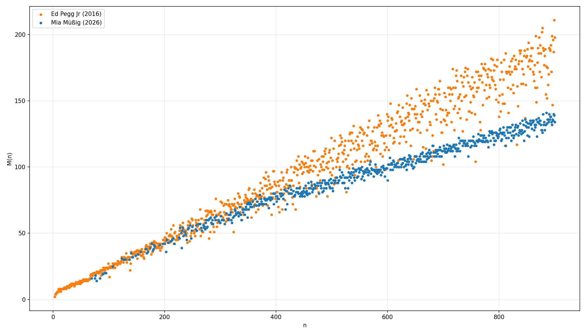
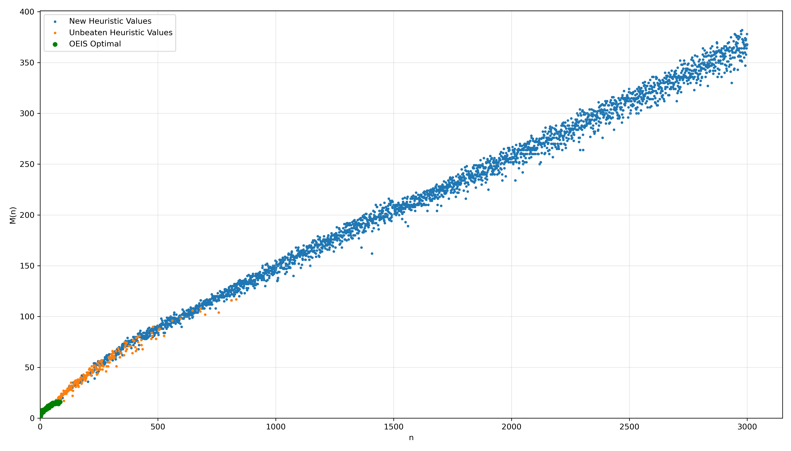
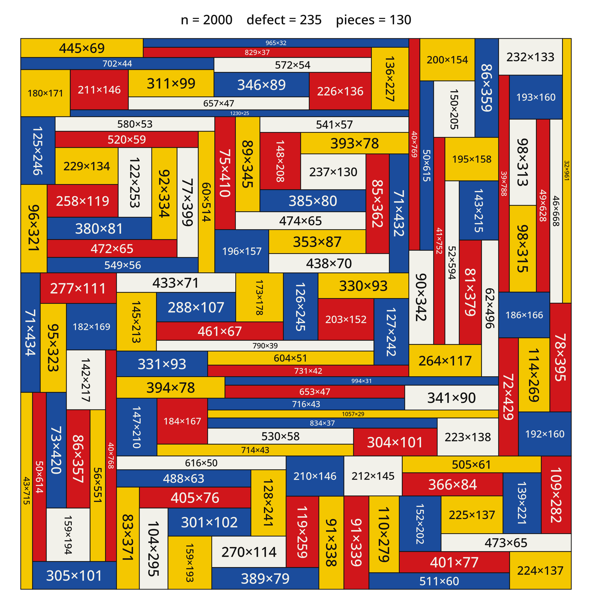

# An Heuristic Solver for the Mondrian Art Problem

### Introduction

The Mondrian Art Problem asks for a partition of the $n \times n$ square into multiple rectangles with integer side lengths, such that no two rectangles are congruent to each other (so if a $2 \times 3$ rectangle is already used, one can't place another $2 \times 3$ or a $3 \times 2$ rectangle). The challenge is to find for a given $n$ the smallest possible defect $M(n)$, which is defined as the difference between the area of the largest rectangle and smallest rectangle. You can try the problem yourself on my [interactive Mondrian Art editor](https://phoenixsmaug.github.io/mondrian-web/).

The optimal values are known up to $n = 66$, and are listed on OEIS as sequence [A276523](https://oeis.org/A276523). In 2016, Ed Pegg Jr published heuristic solutions up to $n = 900$ [on Wolfram Demonstrations](https://demonstrations.wolfram.com/MondrianArtProblem/) (technically his solution for $n = 196$ is invalid, since it contains the rectangle $26 \times 98$ twice). As far as I know, the source code used to find the solution is not public.

In this repository we present a Julia solver, which can achieve significantly lower defect solutions across the board:



It also allows easily to extend heuristic solutions to $n = 3000$ and beyond:



As an example, here is heuristic solution it finds for $n = 2000$:



### How it works

Based on some public notes ([1](https://www.bradyharanblog.com/blog/mondrian-art-puzzle), [2](https://demonstrations.wolfram.com/MrsPerkinssQuilts/)), Ed Pegg Jr seems to have started with a explicit list of diverse rectangle partitions. In `src/generators.jl` we use the optimal solutions for small $n$ from OEIS (`data/import/oeis_solutions.txt`), Ed Pegg Jr's own solutions (`data/import/ed_pegg_jr.json`), random slicing trees based on [Guillotine cuts](https://en.wikipedia.org/wiki/Guillotine_partition) and electrical networks, whose suprising connection to packing problems is explained in [this YouTube video](https://youtu.be/0fH80JF2mDM). Note that we only save the topology, so which rectangles are adjacent to which other, and not the specific side lengths.

We can then apply a given rectangle partition to the $[0, 1] \times [0, 1]$ square and try to find a solution where all rectangles have the same area, but their side lengths are allowed to be real numbers. As explained in [this paper](https://arxiv.org/pdf/2007.09643), this transformation is just a big system of equations, which can easily be solved numerically with the Newton–Raphson method (see `src/geometry.jl`).

For a given $n$, we can then simply try to apply all of the cached $[0, 1] \times [0, 1]$ partitions by scaling them up and then rounding their internal wall coordinates to integers. The search space given by rounding up or down is then explored locally in `src/csp.jl`.

### Prime rectangulations (OEIS A340984)

Slicing trees, quilt substitutions and (to a lesser extent) electrical duals all tend to produce partitions that *factor*: some sub-collection of the rectangles has a rectangular union, so the partition is really a smaller partition with a block substituted into it. A partition where that never happens — no sub-collection of $2 \ldots k-1$ rectangles tiles a rectangle, so in particular no two rectangles share a complete face — is called **prime**, and those are counted by [A340984](https://oeis.org/A340984): $1, 1, 0, 0, 1, 0, 2, 6, 29, 119, 600, 3054, 16143, 88112$ for $k = 1 \ldots 14$. From $k = 12$ on a few classes are *crossed* (four rectangles meet in a point); the solver uses only the cross-free ones, of which there are $3050$, $16095$ and $87549$ for $k = 12, 13, 14$. Prime partitions are exactly the ones the other generators cannot reach by construction, which makes them the natural missing seed family, and they matter for the Mondrian problem specifically: a shared face means two rectangles whose side lengths are locked together, which is precisely the rigidity a low-defect solution wants to avoid.

The catalogue of every class up to $k = 14$ is not included in this repository (about 81 MB). Download `representatives_n1.jsonl` … `representatives_n14.jsonl` from [OEIS_A340984](https://github.com/PhoenixSmaug/OEIS_A340984) into `data/import/a340984/`; without them `init-cache` builds a cache with no primes and `gen-prime` stops with an error. `src/io.jl` ingests them (`parse_a340984`), anisotropically normalizing each integer drawing onto $[0, 1]^2$; `src/prime.jl` can test any floorplan for primality (`is_prime_rectangulation`) and grow new ones.

Above $k = 14$ there is no catalogue, so `src/prime.jl` generates them. Splitting one rectangle of a prime partition in two always creates a block, so the split is followed by a short random walk of T-flips, re-equalizing after each move, until the block is gone; roughly 6% of attempts land on a prime partition with one more rectangle. Feeding each generated level back in as the parent pool for the next climbs the ladder as far as you like:

```bash
julia -t auto mondrian.jl gen-prime --kmax 20 --per-k 25000
```

On 12 threads that takes about 9 minutes and produces **253,446 prime classes** — all 107,452 cross-free ones through $k = 14$ plus 145,994 generated ones for $k = 15 \ldots 20$, de-duplicated up to the dihedral group of the square:

| $k$ | 15 | 16 | 17 | 18 | 19 | 20 |
|---|---|---|---|---|---|---|
| classes | 20,994 | 25,000 | 25,000 | 25,000 | 25,000 | 25,000 |
| rate | 335/s | 337/s | 309/s | 260/s | 273/s | 218/s |

The generated levels are a diverse sample, not an exhaustive enumeration — $a(15)$ alone is around half a million. The result is saved to `data/import/prime_generated.cache` and picked up automatically by `init-cache`, which uses the prime partitions in three places: as seeds for their own T-flip/wall-slide expansion, as substitution blocks for the quilt engine (the pinwheel and its relatives can *only* enter a larger partition by substitution), and as outer root templates for the hierarchical search.

Adding `--jsonl <dir>` also writes the generated partitions out in the catalogue's own schema, one `generated_nK.jsonl` per piece count, snapped onto the integer grid of their wall coordinates (`data/import/prime_generated_jsonl/`). Those files can be drawn with the catalogue's `render.py` exactly like the original representatives.

The crucial new idea over Ed's previous method is to use a two-level hierarchy of rectangles. So if you have a look at the solution for $n = 2000$ above, you'll notice that it is actually a partition of just $13$ big rectangles, each of which is split into $13$ smaller rectangles. As implemented in `src/solver.jl`, this two step optimization makes a search even with a lot of rectangles feasible. So while Ed's solution never used more than 27 rectangles, larger $n$ seems to benefit immensely from this increased number of rectangles.


### An evolved decision layer

Everything in `src/solver.jl` is a decision *about* the machinery above — which hierarchy shapes (R outer rectangles, each split into M inner ones) to try, which outer roots and rounding masks to spend CSP calls on, and how to share the budget between them. That layer was evolved with [ShinkaEvolve](https://github.com/SakanaAI/ShinkaEvolve), an LLM-driven program-evolution loop with Claude writing the proposals. Each candidate was scored as $50 \times \text{mean}(d_{\text{best known}} / d_{\text{found}})$ over 30 values of $n$ in $300 \ldots 3000$ at 900 s per $n$, where "best known" is the table of best-known values $M(n)$ for $n \le 3000$ that the records here are compared against (proven optimal only up to $n = 66$), so 50 means matching it everywhere, and the winners were then re-scored on 50 *disjoint* held-out $n$ they had never been tuned on. Everything below `solver.jl` — the Newton equalizer, the CSP, the corpus, the validator — was left untouched.

Two of the evolved programs are kept, because they are architecturally different and win on different $n$. They share all of their machinery and differ only in the scheduler that spends the budget:

| `--schedule` | how the budget is spent | evolution set | held-out 50 |
|---|---|---|---|
| `bandit` (default) | successive halving over resumable $(R, M)$ arms, with new lattice-neighbour arms folded into the halving rounds as the pool narrows to two or runs out | 55.95 | 55.23, beats best-known on 47 of 50 |
| `race` | successive halving down to one survivor, then widening to neighbours only once the pool has exhausted its own roots | 55.50 | not run |
| `best` | runs both and keeps the lower defect (twice the time) | | |

Evolution did not start from the `solver.jl` that this repository shipped before (whose held-out score was never measured), but from our own earlier rewrite of it, which already chose shapes from a window around a fitted piece-count law, about $2.895\,n^{0.472}$ rectangles, ranked outer roots by how evenly they split the square before spending any CSP call on them, and counted CSP calls as its budget; it scored 52.42 on the same held-out 50 (best-known beaten on 39 of 50). What evolution added on top: shapes are raced as *resumable* arms, so a shape that earns more budget later continues where it stopped instead of starting over; the pool is cut by successive halving; the search widens to neighbouring $(R, M)$ as the pool narrows; and candidate shapes are ordered by their measured quality in an earlier survey. The evolved code also contains a non-uniform arm meant to let the outer boxes carry different numbers of rectangles, but it calls `equalize_weighted` with floating-point weights, for which there is no method, so it has never actually run; it is left as it is so that the file reproduces the evaluated programs exactly (see the comment on `try_make_nonuniform_arm`).

The budget is a *count* of CSP calls, not a wall-clock allowance, so a result is deterministic: the same $n$, cache and schedule give the same dissection, as long as `--timeout` does not cut the search short first. At 900 s per $n$, repeated runs of the evaluation set gave identical results; at 240 s per $n$ it does for $n$ above roughly 1,500, where the result then depends on the speed of the machine.

With `--schedule best --timeout 240` (240 s per $n$ for each schedule), a uniform random sample of 700 values of $n$ in $300 \ldots 3000$ beats the best-known value on 597, ties 32 and is worse on 71; the defect is 6.9 % lower on average (equivalently, the best-known values are on average 7.75 % higher). Because the timeout binds for large $n$ at this setting, those values understate what the solver finds with more time. On this sample `race` alone is better than `bandit` alone on 139 values of $n$ and worse on 79. `records/` holds the resulting values and dissections.


### How to use the solver

Before running the solver for the first time, we need to built the cache of suitable rectangle partitions. With default options it takes around 45s of runtime and results in 115MB of data.
```bash
julia mondrian.jl init-cache
```

That uses the A340984 catalogue in `data/import/a340984/` (download it first, see above). To also seed it with prime partitions above $k = 14$, run the generator *before* `init-cache`, which then finds `data/import/prime_generated.cache` on its own:
```bash
julia -t auto mondrian.jl gen-prime
julia mondrian.jl init-cache
```

Useful `init-cache` switches: `--prime-per-k <NUM>` caps how many prime classes are taken per piece count (`0` for all of them), `--expand-prime <NUM>` sets the expansion target per piece count, and `--no-prime` leaves the primes out (the other partitions are still interleaved per piece count, so this is not byte-for-byte the cache built before the primes were added).

The census values in `records/` were produced with one specific cache (258,064 child topologies, 87,614 of them A340984 primes, and 339 outer roots). `init-cache` itself is seeded, but `gen-prime` is multi-threaded and time-limited, so its output (and with it the cache) depends on the machine; to use the same cache as the records, download `floorplans.cache` and `outer_roots.cache` from this repository's release assets into `data/cache/` instead of running `init-cache`. Values for large $n$ at `--timeout 240` can still differ slightly between machines (see above).

Afterwards, finding a heuristic solution for a given $n$, for example $213$ is just:
```bash
julia mondrian.jl 213
```

To run both evolved schedules and keep the better result (see above):
```bash
julia mondrian.jl 213 --schedule best
```

You can also supply `--deep` to raise the budget from 100 to 3600 CSP calls (not yet evaluated for the evolved layer):
```bash
julia mondrian.jl 213 --deep
```

Note that the specific defect of the solution found can vary by a few tiles, depending on the exact caps and cache initialization seeds used. The solver collects the best solution for each $n$ in `solutions.json`.

Using the short independent `verify.jl`, we can validate that the found solutions are valid solutions:
```
julia verify.jl solutions.json
```

Finally, you can use `plot.jl` to produce images of the solutions; like the $n = 2000$ solution seen above. Keep in mind that it needs further dependencies (`julia -e 'using Pkg; Pkg.add(["Luxor", "PicoSAT"])`).

### AI Declaration

This README is human-written, and all main ideas for the solver were proposed by humans. GPT 5.6 Sol helped optimizing the concrete implementation, especially the local CSP search and the electrical network generator. Additionally, Gemini 3.8 Flash was used to refactor and clean up code.

That statement covers the original solver. For the later additions: the A340984 prime-rectangulation seeds, the enumerator in `enum/` and the scripts in `tools/` were written with Claude, and `enum/certificate.py` is copied from OEIS_A340984. The decision layer in `src/solver.jl` was evolved by ShinkaEvolve, so the scheduler ideas in it (resumable arms, successive halving, rolling widening) were proposed by Claude inside the evolution loop and selected by measured score; Claude also merged the two evolved programs into one file and drafted the README sections describing these additions.
