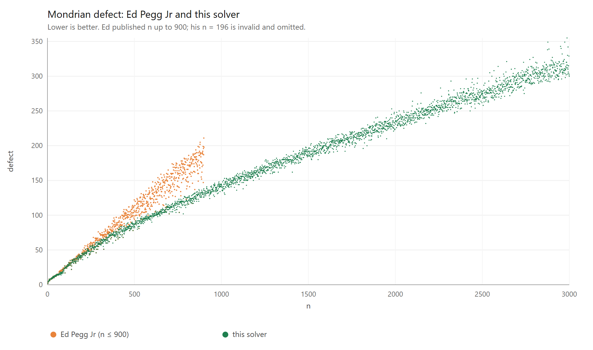

# An Heuristic Solver for the Mondrian Art Problem

### Introduction

The Mondrian Art Problem asks us to cut an $n \times n$ square into rectangles with integer side lengths so that no two rectangles are congruent: once a $2 \times 3$ rectangle is used, neither another $2 \times 3$ nor a $3 \times 2$ may appear. The *defect* of such a partition is the area of its largest rectangle minus the area of its smallest, and the goal is the smallest defect possible for a given $n$, written $M(n)$. You can try the problem yourself on the [interactive Mondrian Art editor](https://phoenixsmaug.github.io/mondrian-web/).

Optimal values are known only up to $n = 66$, and are listed on OEIS as [A276523](https://oeis.org/A276523). For larger $n$ we can only find *heuristic solutions*: valid partitions found by search, with no proof that a smaller defect is impossible. A heuristic solution therefore gives an upper bound on $M(n)$, not its exact value. In 2016 Ed Pegg Jr published heuristic solutions up to $n = 900$ [on Wolfram Demonstrations](https://demonstrations.wolfram.com/MondrianArtProblem/) (his solution for $n = 196$ is in fact invalid, since it uses the rectangle $26 \times 98$ twice); as far as we know, the code behind them is not public.

This repository presents a Julia solver that finds lower defects across the board:


It also extends heuristic solutions to $n = 3000$ and beyond:


As an example, here is the solution it finds for $n = 2000$:


### How it works

Judging by public notes ([1](https://www.bradyharanblog.com/blog/mondrian-art-puzzle), [2](https://demonstrations.wolfram.com/MrsPerkinssQuilts/)), Ed Pegg Jr started from an explicit list of diverse rectangle partitions, and this solver does the same. The list is built in `src/generators.jl` from the optimal solutions for small $n$ (`data/import/oeis_solutions.txt`), Ed Pegg Jr's own solutions (`data/import/ed_pegg_jr.json`), random slicing trees based on [guillotine cuts](https://en.wikipedia.org/wiki/Guillotine_partition), and electrical networks, whose surprising connection to packing problems is explained in [this video](https://youtu.be/0fH80JF2mDM). Only the topology of each partition is stored, meaning which rectangle is adjacent to which, not its side lengths.

A topology is placed on the unit square, and the solver looks for real side lengths that give every rectangle the same area. As explained in [this paper](https://arxiv.org/pdf/2007.09643), that is a system of equations, solved numerically with the Newton–Raphson method in `src/geometry.jl`. For a given $n$ the solver scales these partitions up and rounds their interior walls to integers; the choices of rounding each wall up or down are then explored by a local constraint search, the CSP in `src/csp.jl`.

The crucial idea, beyond Ed's method, is a two-level hierarchy. The $n = 2000$ solution above is a partition into just $13$ big rectangles, each of which is split into $13$ smaller ones. Optimizing the two levels separately makes a search with many rectangles feasible. Ed's solutions never used more than 27 rectangles, and larger $n$ benefit greatly from using more.

### Prime rectangulations (OEIS A340984)

Slicing trees, quilt substitutions and, to a lesser extent, electrical networks tend to produce partitions that *factor*: some sub-collection of the rectangles has a rectangular union, so the partition is really a smaller partition with a block substituted into it. A partition of $k$ rectangles in which no $2$ to $k-1$ of them tile a rectangle is called *prime*. The smallest example is the pinwheel, with five rectangles around a central one. Prime partitions are counted by [A340984](https://oeis.org/A340984): $1, 1, 0, 0, 1, 0, 2, 6, 29, 119, 600, 3054, 16143, 88112$ for $k = 1$ to $14$. From $k = 12$ on, a few of these are *crossed*, with four rectangles meeting at a point; the solver uses only the cross-free ones, of which there are $3050$, $16095$ and $87549$ for $k = 12, 13, 14$.

Prime partitions are exactly the ones the other generators cannot produce by construction, which makes them the natural missing family of seeds. They also matter for this problem in particular: two rectangles that share a complete side have their side lengths locked together, and that is precisely the rigidity a low-defect solution needs to avoid.

The complete catalogue up to $k = 14$ is not included in this repository (about 81 MB). Download `representatives_n1.jsonl` to `representatives_n14.jsonl` from [OEIS_A340984](https://github.com/PhoenixSmaug/OEIS_A340984) into `data/import/a340984/`. The function `parse_a340984` in `src/io.jl` reads them and normalizes each drawing onto the unit square, and `src/prime.jl` can test any partition for primality (`is_prime_rectangulation`) and grow new ones.

Above $k = 14$ there is no catalogue, so the solver generates prime partitions itself. Splitting one rectangle of a prime partition in two always creates a block, so the split is followed by a short random walk of T-flips, re-equalizing after each move, until the block is gone; about 6% of attempts give a prime partition with one more rectangle. Each generated level becomes the parent pool for the next:

```bash
julia -t auto mondrian.jl gen-prime --kmax 20 --per-k 25000
```

On 12 threads this takes about 9 minutes and gives 253,446 prime classes, counted up to rotation and reflection: the 107,452 cross-free classes through $k = 14$, and 145,994 generated ones for $k = 15$ to $20$.

| $k$ | 15 | 16 | 17 | 18 | 19 | 20 |
|---|---|---|---|---|---|---|
| classes | 20,994 | 25,000 | 25,000 | 25,000 | 25,000 | 25,000 |

The generated levels are a diverse sample, not a complete enumeration; the count for $k = 15$ alone is around half a million. They are saved to `data/import/prime_generated.cache`, which the cache builder picks up automatically and uses in three ways: as seeds for its own expansion, as blocks for quilt substitution (the pinwheel and its relatives can enter a larger partition only by substitution), and as outer templates for the two-level search. Adding `--jsonl <dir>` also writes them in the catalogue's own format, so the catalogue's `render.py` can draw them.

### An evolved decision layer

The machinery above produces candidate partitions; the decision layer in `src/solver.jl` decides how to spend effort on them. It chooses which hierarchy shapes to try, where a shape $(R, M)$ means $R$ outer rectangles each split into $M$ inner ones; which outer roots and rounding masks get CSP calls; and how a fixed budget of CSP calls is shared out. We evolved this layer with [ShinkaEvolve](https://github.com/SakanaAI/ShinkaEvolve), an LLM-driven program-evolution loop, and left everything below it untouched. Each candidate program was scored on 30 values of $n$ between 300 and 3000, at 900 s per $n$, by the quantity
$$50 \times \text{mean}\left(\frac{d_{\text{best known}}}{d_{\text{found}}}\right),$$
so that a score of 50 means matching the best-known values everywhere. The winners were then scored again on 50 other values of $n$ they had never been tuned on.

**Successive halving.** The budget for each $n$ is 100 CSP calls, and there are about 16 candidate shapes, called *arms*. Successive halving gives every arm a small equal share of calls, ranks the arms by the best defect each has found, keeps the better half and repeats with a larger share for each survivor. Arms whose share is not enough for a valid partition yet are ranked by an estimated defect that costs no calls. The arms are *resumable*: an arm that survives a round continues from where it stopped, so nothing it explored is repeated. In the default schedule, for example, 16 arms get 2 calls each in the first round, the 8 survivors 4 each, and the 4 after that 8 each, about 32 calls per round, so most of the budget ends up on the shapes that are actually producing low defects.

Two evolved programs are kept because they win on different $n$. They share all their machinery and differ only in when the scheduler adds new arms, namely the neighbouring shapes $(R \pm 1, M)$ and $(R, M \pm 1)$ of the best arm:

| `--schedule` | when neighbouring arms are added | evolution set | held-out 50 |
|---|---|---|---|
| `bandit` (default) | as soon as two or fewer arms survive; they join the next round of halving | 55.95 | 55.23, best known beaten on 47 of 50 |
| `race` | only after the pool has halved to one survivor and every arm has run out of roots | 55.50 | not run |
| `best` | runs both schedules and keeps the lower defect, taking twice the time | | |

Evolution started from our earlier rewrite of `solver.jl`, which scored 52.42 on the same held-out values (39 of 50 beaten). That rewrite already chose shapes near a fitted piece-count law of about $2.895\,n^{0.472}$ rectangles, ranked outer roots by how evenly they split the square before spending any call on them, and counted CSP calls as its budget. Evolution added the resumable arms, successive halving, the widening to neighbouring shapes, and an ordering of shapes by their measured quality in an earlier survey. The evolved code also contains a non-uniform arm that never runs, because it calls `equalize_weighted` with floating-point weights, for which there is no method; we leave it in so that the file reproduces the evaluated programs exactly.

Because the budget is a count of calls, a result is deterministic as long as `--timeout` does not cut the search short. At 240 s per $n$ the timeout does cut it short for $n$ above roughly 1500, where results then depend on the speed of the machine. Even at 900 s it can at the largest $n$: with `race`, the value $n = 2713$ gave 265 in one run and 280 in another.

### Results

With `--schedule best --timeout 240` we ran every $n$ from 300 to 3000. Of these 2701 values the best-known one is beaten on 2311, tied on 110 and not reached on 280, and the defect is 6.9% lower on average. Almost every value not beaten lies below $n = 800$; from $n = 1200$ on, only 27 of 1801 are. On its own, `race` is better than `bandit` on 581 values of $n$ and worse on 314.



The directory `records/` holds the result for every $n$ from 67 to 3000, each re-verified by an independent checker. The file `values.txt` is the best-known table with our value wherever it is lower (2338 values), `solutions.json` holds those partitions in the solver's corner format, `census.jsonl` gives both schedules' defects for every $n$, and `non_beats.csv` lists the 486 values $n \ge 180$ that we tie or lose, with the gaps and the tile counts of both partitions.

### What we tried

The table lists the main changes we measured, in score points on the 50-point scale above. The first three were measured while building the starting layer; the others were measured against the evolved program on the 30-value evolution set, where it scores 55.95.

| Change | Result | Score change |
|---|---|---|
| Choose the number of rectangles from the fitted law $2.895\,n^{0.472}$ | kept | +2.5 |
| Count CSP calls instead of wall-clock time | kept, and makes runs repeatable | +1.9 |
| Rank outer roots by how evenly they split the square, try the best 10 to 12 | kept | +0.67 |
| Resumable arms, successive halving and widening (evolved) | kept | held-out 52.42 to 55.23 |
| Re-equalize each outer box for its own aspect ratio | failed | −1.19 |
| Add a third level of hierarchy | failed | −1.13 |
| Replace the quality-ordered shape list with a prior-free scorer | failed | −0.92 |
| Rewrite the search as a genetic algorithm | failed | −0.99 |
| Try a ladder of CSP slack windows | failed | −1.45 |
| Non-uniform arm, letting outer boxes hold different numbers of rectangles: in the evolved code it never ran (it passes floating-point weights to `equalize_weighted`); switched on with integer weights | failed when on: never the winner on any of the 30 values | −0.13 |
| Keep topologies that cannot be equalized exactly, or grow children past $M = 18$ | no effect: never selected on any of the 30 values | 0 |
| Admit shapes with as few as 0.2 times the law's rectangles | no effect: never selected; held-out 55.17 and 54.88 against 55.23 | 0 |
| Few-tile constructions like the best-known values at $n = 324$, 406 and 526, which use 0.23 to 0.33 times the law | untried | |
| Allow $R$ above 14 for $n$ well beyond 3000 (at $n \approx 7000$ the cap holds us to 0.93 times the law) | untried | |

### How to use the solver

Before the first run, download the A340984 catalogue (see above) and build the cache of rectangle partitions. With the default options this takes about 45 s and produces 115 MB of data. To include the generated prime partitions above $k = 14$, run the generator first; the cache builder then finds its output on its own:
```bash
julia -t auto mondrian.jl gen-prime
julia mondrian.jl init-cache
```

Useful options for the cache builder are `--prime-per-k <NUM>`, which caps the prime classes taken per piece count (`0` for all of them), `--expand-prime <NUM>`, which sets the expansion target per piece count, and `--no-prime`, which leaves the primes out. The generator is multi-threaded and time-limited, so its output, and with it the cache, varies from machine to machine. To use exactly the cache behind `records/`, download `floorplans.cache` and `outer_roots.cache` from this repository's release assets into `data/cache/` instead of building one.

Finding a heuristic solution for a given $n$, for example $213$, is then just:
```bash
julia mondrian.jl 213
```

To run both evolved schedules and keep the better result:
```bash
julia mondrian.jl 213 --schedule best
```

The flag `--deep` raises the budget from 100 to 3600 CSP calls; we have not yet evaluated it for the evolved layer:
```bash
julia mondrian.jl 213 --deep
```

The solver collects the best solution found for each $n$ in `solutions.json`. The short, independent `verify.jl` checks that they are valid:
```bash
julia verify.jl solutions.json
```

Finally, `plot.jl` draws solutions such as the $n = 2000$ example above. It needs two further packages, installed with `julia -e 'using Pkg; Pkg.add(["Luxor", "PicoSAT"])'`.

### AI Declaration

The original solver and the original version of this README were written by Mia Muessig, and all main ideas for that solver were proposed by humans. GPT 5.6 Sol helped optimize the implementation, especially the local CSP search and the electrical network generator, and Gemini 3.8 Flash was used to refactor and clean up code.

The later additions were directed by Thomas Garrison, who proposed many of their ideas, and were written with Claude, partly inside the ShinkaEvolve loop; `enum/certificate.py` is copied from OEIS_A340984. This README, in its present form, was written by Claude.
